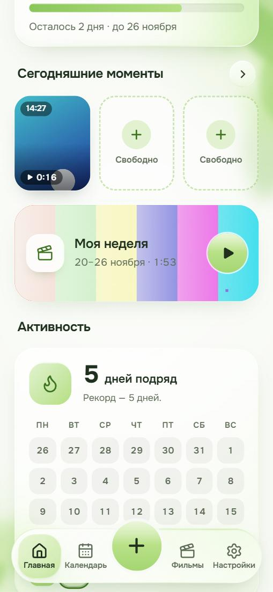
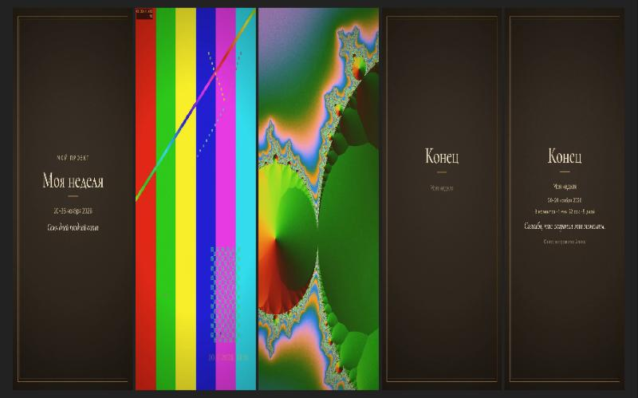

# Flash — Personal Life Diary

Приватный видеодневник: записываешь от одного до трёх коротких моментов в день (от 10 секунд), а Flash сам собирает из них фильмы с титрами, музыкой и переходами — за день, неделю, месяц, год или за целый «проект воспоминаний».

**Открыть приложение:** <https://kaufmanbora-lang.github.io/flash/>

Flash — веб-приложение без сервера. Оно целиком работает в браузере и размещается на GitHub Pages как набор статических файлов:

- **видео и фильмы хранятся только на устройстве** (IndexedDB браузера) и никуда не отправляются;
- **фильмы монтируются прямо в браузере** — кадры, титры, цветокоррекция, музыка, запись в MP4;
- **аккаунтов и паролей нет**, приложение работает без интернета и ставится на экран «Домой» как обычное.

<p>
  
  
</p>



## Что умеет

- **Запись момента** с камеры (от 10 секунд, с защитой от случайного закрытия приложения) или загрузка видео из галереи за любой прошедший день. В один день — от 1 до 3 моментов.
- **Автоматические фильмы**: день, неделя, месяц, год, свой период. Версии «Полный» и Highlights (самые живые фрагменты — по громкости звука и движению в кадре).
- **Пять стилей монтажа** (Minimal, Cinematic, Memories, Vintage, Clean) — цветокоррекция, переходы, оформление титров; в режиме «Авто» стили чередуются.
- **Музыка**: 21 оригинальная композиция в семи настроениях. Музыка сама становится тише, когда в видео звучит речь, композиции не повторяются от фильма к фильму.
- **Титры**: вступление («23 ноября 2026 / Понедельник / A little piece of my life.»), подписи с датой и временем, главы для длинных фильмов, финал со статистикой.
- **Проекты воспоминаний**: период от 1 дня до года (или бессрочно), прогресс и календарь проекта, пауза и продление, досрочное завершение, четыре версии финального фильма (трейлер, мини, расширенный, полный), обложка из кадров.
- **Архив**: календарь, поиск по дате и по словам заметки, избранное, статистика, «В этот день» год назад.
- **Плеер**, сохранение файла и «Поделиться» через системное меню (Telegram, WhatsApp и другие).
- **Напоминания** через календарь телефона: Flash готовит файл с событиями, которые приходят, даже когда приложение закрыто.
- **Резервная копия**: весь дневник одним ZIP-архивом — и восстановление из него на любом устройстве.

## Важно знать

- Дневник живёт в данных браузера на этом устройстве. Если очистить данные сайта или удалить браузер, дневник пропадёт. В «Настройках» есть кнопки «Сохранить архив» и «Защитить от очистки» — пользуйтесь ими.
- Между устройствами дневник не синхронизируется сам: его переносит архив (сохранить на одном устройстве → восстановить на другом).
- Для сборки фильмов нужен современный браузер с WebCodecs: Chrome, Edge, Safari 16.4+ (звук в фильме — Safari 26+), Firefox 130+. Записывать и смотреть моменты можно в любом современном браузере.
- Формат фильма — MP4 (H.264 + AAC). Если браузер не умеет его кодировать, получится WebM.
- Пока фильм собирается, приложение нужно держать открытым. На компьютере сборка идёт в несколько раз быстрее длительности фильма, на телефоне — примерно в темпе просмотра.
- Сайты одного автора на GitHub Pages делят один адрес (`username.github.io`), а значит и хранилище браузера. Flash использует собственные имена баз и кэшей и чужие данные не трогает.

## Как устроено

```
src/
  app/            экраны (Next.js App Router, статический экспорт)
  components/     интерфейс: «жидкое стекло», плеер, шторки
  client/         запросы к данным, камера, PWA
  lib/            чистая логика: даты, проекты, выбор фрагментов, поиск
  local/          «сервер внутри приложения»
    store.ts        хранилище на устройстве (IndexedDB): записи и файлы
    api.ts          маршрутизатор: экраны обращаются по адресам /api/…, ответ приходит из хранилища
    moments.ts, projects.ts, films.ts, home.ts   логика дневника
    analyze.ts      фоновый анализ момента (громкость и движение по секундам)
    backup.ts, zip.ts   резервная копия в ZIP (с поддержкой архивов больше 4 ГБ)
    calendar.ts     напоминания в формате календаря (.ics)
    render/         монтаж фильма в браузере
      plan.ts         план: отрезки, титры, переходы — в кадрах
      compositor.ts   сборка кадра: вписывание, цветокоррекция, переходы
      titles.ts       титры и подписи на canvas
      audio.ts        сведение звука: клипы, музыка, приглушение под речь, ограничитель
      sources.ts      чтение исходных видео (WebCodecs через mediabunny)
      engine.ts       цикл сборки и кодирование в MP4
  music/          синтезатор, которым создана музыкальная библиотека
public/sw.js      Service Worker: приложение открывается без сети
```

Экраны читают данные по тем же адресам, что и в серверной версии (`/api/home`, `/api/moments?date=…`), но запрос никуда не уходит: его разбирает `src/local/api.ts` и отвечает из IndexedDB. Монтаж не привязан к реальному времени: кадры декодируются из исходных файлов, собираются на canvas и сразу кодируются; готовый файл пишется на диск страницами, поэтому память не растёт с длиной фильма.

## Запуск у себя

Нужен Node.js 22.12 или новее.

```bash
npm install
npm run music     # один раз: создаёт музыкальную библиотеку в public/music (около минуты)
npm run dev       # http://localhost:3000
```

Проверки:

```bash
npm run typecheck
npm test          # 70 тестов: дневник поверх IndexedDB, проекты, план фильма, звук, архив, поиск
```

Сборка такой же, как на GitHub Pages (сайт в подпапке `/flash`):

```bash
NEXT_PUBLIC_BASE_PATH=/flash npm run build   # в PowerShell: $env:NEXT_PUBLIC_BASE_PATH="/flash"; npm run build
npm run preview                              # http://localhost:3000/flash/
```

Результат сборки — папка `out`: её можно положить на любой статический хостинг. Если сайт будет лежать в корне домена, переменную `NEXT_PUBLIC_BASE_PATH` не задавайте.

## Публикация

Сайт собирает и публикует GitHub Actions (`.github/workflows/pages.yml`) при каждой отправке в ветку `github-pages`: установка зависимостей → проверка типов → тесты → музыка (кэшируется) → сборка → GitHub Pages.

## Ветки

- `github-pages` — это приложение (работает целиком в браузере).
- `server` — прежняя серверная версия (Next.js + PostgreSQL + FFmpeg-воркер + Docker Compose): с аккаунтами, синхронизацией между устройствами и push-уведомлениями. Ей нужен собственный сервер.

## Лицензии

Шрифты Cormorant Garamond и Onest — SIL Open Font License. Библиотека [mediabunny](https://mediabunny.dev) — MPL-2.0. Музыка создана синтезатором из этого репозитория.
