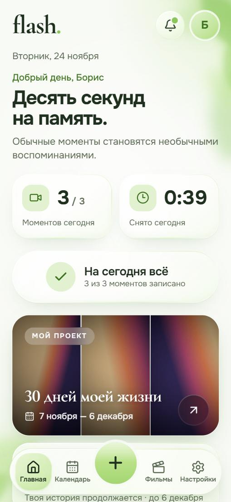
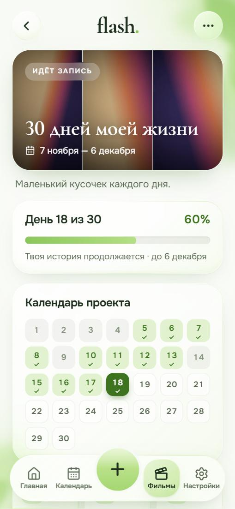
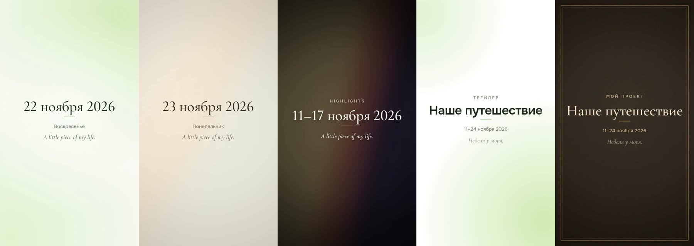

# Flash — личный видеодневник

Flash — приватное PWA-приложение: записываешь короткие моменты своей жизни (от одного до трёх в день,
каждый не короче 10 секунд), а сервер сам собирает из них фильмы — с заставкой, датами, переходами,
музыкой и титрами. Никаких лент, лайков и публичных профилей: всё видишь только ты.

- **Фильмы** за день, неделю, месяц, год и произвольный период; полная версия и Highlights.
- **Проекты воспоминаний** — «30 дней моей жизни», «Моё лето»: срок, прогресс, календарь,
  финальный фильм в четырёх версиях (трейлер, мини-фильм, расширенный, полный).
- **Настоящий монтаж FFmpeg** в отдельном воркере, музыка с автоматическим приглушением под речь.
- **PWA** для iPhone и Android: установка на домашний экран, офлайн-черновики, push-напоминания.

| Главный экран | Проект воспоминаний |
|---|---|
|  |  |

Заставки фильма в пяти стилях (Minimal, Memories, Cinematic, Clean, Vintage) и финальные титры —
кадры из фильмов, собранных на демо-данных:




## Быстрый старт (без Docker)

Нужен только [Node.js 22.12+](https://nodejs.org/). PostgreSQL и FFmpeg для разработки ставятся
вместе с зависимостями (пакеты `embedded-postgres`, `ffmpeg-static`), видео хранятся в папке `.data/`.

```bash
npm install
npm run dev
```

Откройте <http://localhost:3000>, зарегистрируйтесь — и можно записывать. `npm run dev` запускает три
процесса: базу (`dev:db`), сайт (`dev:web`) и воркер (`dev:worker`). При первом запуске воркер около
минуты создаёт музыкальную библиотеку.

> Камера, установка PWA и push работают только на `https://` или на `localhost`. Чтобы открыть
> приложение с телефона, пробросьте порт туннелем с HTTPS (например, `cloudflared tunnel --url
> http://localhost:3000`) и укажите полученный адрес в `APP_URL`.

## Запуск в Docker

```bash
cp .env.example .env        # задайте APP_SECRET, APP_URL, S3_SECRET_KEY
docker compose up -d --build
```

Поднимаются четыре сервиса (и разовый помощник `storage-init`, который выставляет права на том хранилища):

| Сервис     | Что делает                                                                  |
|------------|-----------------------------------------------------------------------------|
| `postgres` | база данных и очередь фоновых задач                                         |
| `storage`  | приватное S3-совместимое хранилище видео ([RustFS](https://rustfs.com/))    |
| `web`      | сайт и API (Next.js), порт 3000                                             |
| `worker`   | обработка видео, монтаж FFmpeg, напоминания, фильм дня, завершение проектов |

Хранилище наружу не публикуется: файлы отдаёт только приложение по временным подписанным ссылкам.
Вместо RustFS подойдёт любое S3-совместимое хранилище (AWS S3, Cloudflare R2, Backblaze B2, SeaweedFS,
Garage) — поменяйте переменные `S3_*`. Для простой установки на одном сервере можно обойтись и без S3:
`STORAGE_DRIVER=local`.

### HTTPS

Поставьте перед `web` любой обратный прокси с сертификатом. Пример для [Caddy](https://caddyserver.com/):

```
flash.example.com {
    reverse_proxy localhost:3000
}
```

После этого задайте `APP_URL=https://flash.example.com` и перезапустите контейнеры.

## Переменные окружения

Полный список с комментариями — в [.env.example](.env.example).

| Переменная | По умолчанию | Назначение |
|---|---|---|
| `APP_URL` | `http://localhost:3000` | публичный адрес приложения; от него зависят защищённые cookie и ссылки в уведомлениях |
| `APP_SECRET` | — (обязательна в продакшене) | секрет для подписи временных ссылок на файлы |
| `INVITE_CODE` | пусто | если задан, регистрация возможна только с этим кодом |
| `DATABASE_URL` | встроенный Postgres на порту 15432 | строка подключения к PostgreSQL |
| `STORAGE_DRIVER` | `local` | `local` — папка на диске, `s3` — S3-совместимое хранилище |
| `STORAGE_LOCAL_DIR` | `.data/storage` | папка для `local` |
| `S3_ENDPOINT`, `S3_REGION`, `S3_BUCKET`, `S3_ACCESS_KEY`, `S3_SECRET_KEY`, `S3_FORCE_PATH_STYLE` | — | параметры хранилища для `s3`; бакет создаётся автоматически |
| `STORAGE_QUOTA_GB` | `0` | лимит хранилища на пользователя, 0 — без лимита |
| `VAPID_PUBLIC_KEY`, `VAPID_PRIVATE_KEY` | создаются сами | ключи Web Push; `npm run vapid` выдаёт новую пару |
| `VAPID_SUBJECT` | `APP_URL` | контакт для push-сервисов (`mailto:` или `https://`) |
| `FFMPEG_PATH`, `FFPROBE_PATH` | из `PATH` | пути к бинарникам FFmpeg |
| `FILM_CRF`, `FILM_PRESET` | `18`, `fast` | качество и скорость кодирования H.264 |
| `WORK_DIR` | системная temp | папка временных файлов монтажа |
| `WORKER_PORT` | `3101` | порт health-проверки воркера (`/health`) |

Сгенерировать `APP_SECRET`:

```bash
node -e "console.log(require('crypto').randomBytes(48).toString('base64url'))"
```

## Команды

| Команда | Действие |
|---|---|
| `npm run dev` | база + сайт + воркер для разработки |
| `npm run build` / `npm run start` | production-сборка и запуск сайта |
| `npm run start:worker` | запуск воркера |
| `npm run migrate` | применить миграции (сайт и воркер делают это сами при старте) |
| `npm run music` | заново создать музыкальную библиотеку |
| `npm run icons` | заново нарисовать иконки и заставки PWA |
| `npm run typecheck` | проверка типов |
| `npm test` | модульные тесты |
| `npm run test:e2e` | сквозная проверка запущенного приложения (см. ниже) |
| `npm run test:smoke` | быстрая проверка production-сборки: страницы, API, регистрация, CSRF (см. ниже) |
| `npm run seed` | демо-данные для знакомства: две недели моментов, два проекта, фильмы (нужен запущенный `npm run dev`; аккаунт задан в `scripts/seed-demo.ts`) |

## Как это устроено

```
src/app            страницы (App Router) и API-маршруты
src/components     интерфейс: оболочка, плеер, моменты, фильмы, проекты
src/client         код браузера: камера, IndexedDB, загрузка частями, push, шаринг
src/lib            общая логика сайта и воркера: база, хранилище, сервисы, даты
src/worker         воркер: обработка момента, монтаж фильма, титры, планировщик
src/music          программный синтезатор и композитор музыки
src/i18n           словари интерфейса, push-уведомлений и титров
db/migrations      SQL-схема
public/sw.js       Service Worker
```

**Запись и загрузка.** Видео пишется через MediaRecorder (MP4 на iPhone, WebM/MP4 в Chrome) с
битрейтом 8 Мбит/с. Во время записи куски по мере поступления (раз в 1–4 секунды, зависит от браузера)
ложатся в IndexedDB, готовый момент сохраняется там же как черновик и отправляется на сервер частями
по 6 МБ. Обрыв сети или перезагрузка не теряют запись: загрузка продолжается с последней принятой
части. Если приложение закрыли прямо во время съёмки, на главном экране появится предложение сохранить
то, что успело записаться (если набралось 10 секунд).

**Обработка.** Воркер проверяет длительность (не короче 10 секунд), снимает кадр-превью, делает
версию для плеера (MP4 H.264 + AAC — её играют и Safari, и Chrome; HDR с iPhone приводится к SDR) и
считает «профиль интересности» по секундам — громкость звука и движение в кадре. Оригинал не меняется.

**Монтаж.** Каждый элемент фильма (заставка, глава, клип, финал) приводится к общему формату и
режется на «голову», «тело» и «хвост»; переход между соседями — отдельный короткий файл (`xfade` +
`acrossfade`); затем всё склеивается без перекодирования, поверх накладывается музыка с
`sidechaincompress` — она сама стихает, когда в видео говорят. Длительности считаются в кадрах, звук —
в сэмплах, поэтому рассинхрон не накапливается, а память не зависит от числа моментов. Версии
Highlights, трейлер, мини и расширенная собираются из лучших отрезков по профилю интересности.
Пять стилей оформления: Minimal, Cinematic, Memories, Vintage, Clean. Титры рисуются шрифтами
Cormorant Garamond и Onest (лицензия OFL, ставятся вместе с зависимостями). Кодирование — постоянное
качество (`FILM_CRF`) с потолком битрейта (≈4 Мбит/с для 720p, ≈9 Мбит/с для 1080p), чтобы фильм
оставался удобным для отправки.

**Проекты.** Момент попадает в проект, только если снят в его период (окончание сдвигается на время
пауз): видео из галереи с прошлогодней датой в сегодняшний проект не добавится. Один момент может
лежать в нескольких проектах — видео при этом не дублируется, хранится только связь.

**Без сети.** В production service worker сохраняет оболочку приложения — основные разделы вместе с
их скриптами и стилями, — а последние загруженные данные лежат в `localStorage`. Поэтому приложение
открывается и без сети; для страниц, которых на устройстве ещё нет, показывается самодостаточный экран
`public/offline.html`. В режиме разработки кэширование выключено.

**Поиск.** Заметки ищутся по подстроке и с учётом русских словоформ («море» находит «у моря»).
Регистр понижает приложение (колонка `moments.note_norm`), поэтому поиск одинаково работает при любой
локали базы данных.

**Музыка.** В проекте нет чужих записей: 21 композиция в семи стилях (Relaxing Piano, Soft Ambient,
Warm Memories, Chill Acoustic, Dreamy Cinematic, Nostalgia, Happy Moments) синтезируется кодом из
`src/music` — их можно свободно использовать в экспортируемых фильмах. Стиль и трек чередуются от
фильма к фильму. Свои композиции добавляются через `assets/music/custom.json` (формат как у
`manifest.json`, файлы кладутся рядом).

**Уведомления.** Планировщик в воркере раз в полминуты составляет расписание напоминаний на день по
местному времени каждого пользователя (случайно внутри активного периода или по заданным часам, с
учётом тихих часов) и рассылает их через Web Push (VAPID). Если идёт проект, текст рассказывает о его
прогрессе; на один слот приходит одно уведомление, сколько бы проектов ни было. После трёх моментов за
день напоминания замолкают до завтра.

**Приватность.** Каждый запрос к API проверяет сессию и принадлежность объекта пользователю. Файлы
лежат в хранилище под префиксом `u/<id пользователя>/`, ссылки на них подписаны (HMAC) и живут
несколько часов. В настройках есть экспорт всего архива в ZIP и удаление всех данных или аккаунта.

## Push на iPhone

Apple доставляет web-push только приложениям, добавленным на экран «Домой» (iOS 16.4+):

1. Откройте Flash в Safari по `https://`.
2. «Поделиться» → «На экран „Домой“».
3. Запустите Flash с домашнего экрана и включите напоминания — приложение предложит это само.

Укажите в `VAPID_SUBJECT` настоящий `mailto:` или `https://`-адрес: push-сервис Apple отклоняет
запросы с заглушками вроде `localhost`.

## Проверка

```bash
npm test                 # даты, прогресс проектов, выбор фрагментов, расписание, подписи ссылок
npm run typecheck
npm run build
```

Сквозной сценарий проверяет живое приложение: регистрацию, загрузку частями, лимит трёх моментов,
отказ для коротких видео, монтаж фильмов настоящим FFmpeg, проект с паузой и финальным фильмом,
push, изоляцию данных двух пользователей, экспорт и удаление.

```bash
npm run dev          # в одном терминале
npm run test:e2e     # в другом терминале
```

Чтобы сценарий проверил и отправку push, запустите сайт с переменной `PUSH_ALLOW_ANY_ENDPOINT=1`
(в PowerShell: `$env:PUSH_ALLOW_ANY_ENDPOINT = "1"; npm run dev`). Она разрешает подписку на локальный
тестовый адрес и действует только вне production: в обычном режиме сервер принимает подписки лишь
настоящих push-сервисов браузеров.

Production-сборку проверяет короткий сценарий без воркера и FFmpeg — страницы, манифест, service
worker, закрытость API без входа, регистрация, защита от запросов с чужого сайта, удаление аккаунта:

```bash
npm run build
APP_SECRET=любая-длинная-строка npm run start     # в одном терминале
npm run test:smoke                                 # в другом (адрес — BASE_URL)
```

В PowerShell переменная задаётся так: `$env:APP_SECRET = "любая-длинная-строка"; npm run start`.

## Добавить язык

Скопируйте `src/i18n/ru.ts` в новый файл, переведите значения и зарегистрируйте словарь в
`src/i18n/index.ts`. Типы не дадут пропустить ни одной строки; язык появится в настройках.

## Ограничения

- Монтаж длинных проектов требователен к процессору: фильм кодируется программно (libx264).
  Ускорить сборку можно через `FILM_PRESET=veryfast`, сохранить больше деталей — через `FILM_CRF=16`.
- Web Share с файлом работает в Safari на iPhone и в Chrome на Android; в остальных браузерах
  остаётся скачивание и временная ссылка.
- Смена камеры доступна до начала записи: MediaRecorder не умеет менять источник на лету.
